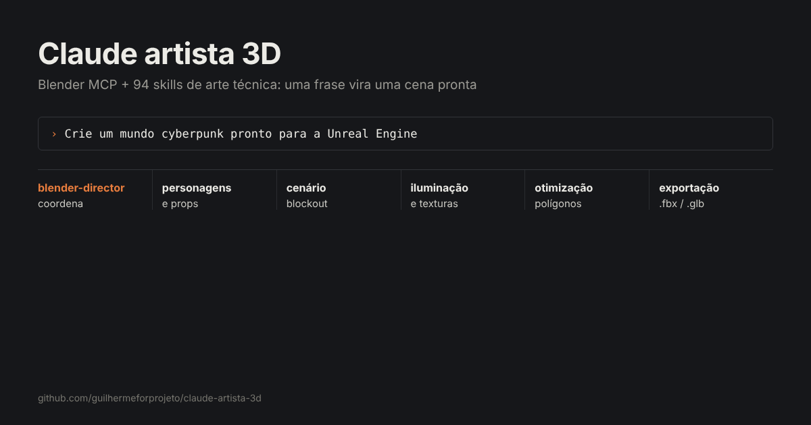

# Claude 3D artist

**Put Claude Code to work inside Blender like a technical art team: 94 specialist skills, a director that coordinates them, and a workflow that shows every stage before moving on. Send the link to your AI and it knows what to do.**

[🇧🇷 Português](README.md) | 🇺🇸 English



---

## Easiest way: send the link to your AI

Open Claude Code (or Cursor, Codex, Kiro) in your project folder, with Blender open, and paste:

```text
Read https://github.com/guilhermeforprojeto/claude-artista-3d and follow AGENTS.md. I want [describe the scene, e.g. a cyberpunk world ready for Unreal].
```

The AI reads [`AGENTS.md`](AGENTS.md) (in Portuguese; it will still follow it), checks what's installed, asks your permission to install what's missing, walks you through enabling the Blender addon, asks the brief questions and builds the scene following [`prompts/en.md`](prompts/en.md).

## What's included

| Piece | What it does |
|---|---|
| [**Blender MCP**](https://github.com/ahujasid/mcp-for-blender) | The bridge between the AI and Blender: creates and edits objects, runs Python and takes viewport screenshots |
| [**Blender Skills**](https://github.com/arjun988/blender-skills) | 94 skills for modeling, props, environments, characters, lighting, textures, optimization, export and art styles |
| **`blender-director`** | The skill that takes your request, breaks it into stages and calls the specialists in order |
| **Workflow** (this repo) | Plan → blockout → screenshot → refine → light and materials → optimize → export, saving versions along the way |

## Manual install

Requires **Blender**, **git** and **Claude Code**. Run it **from inside your project folder**:

```bash
bash /path/to/instalar.sh                                          # macOS / Linux
powershell -ExecutionPolicy Bypass -File C:\path\to\instalar.ps1   # Windows
```

The script installs `uv` if missing, registers the Blender MCP (telemetry off) and copies the 94 skills into your project's `.claude/skills/`. Then enable the addon in Blender: download `addon.py` from [ahujasid/mcp-for-blender](https://github.com/ahujasid/mcp-for-blender), install it under *Edit → Preferences → Add-ons*, enable **Blender MCP**, press **N** → **BlenderMCP** tab → **Connect**, and restart Claude Code.

## Before you use it

- **The AI runs code inside your Blender.** Save your work first and use it on your own files.
- **It doesn't replace an artist's eye.** It handles the technical, repetitive work; composition and style are still your call, which is why the workflow shows screenshots at every stage.
- **Asset licenses.** If it downloads models or textures, it must tell you each one's license.

## Credits

The idea comes from a TikTok video by **[@gabrieladamuchi](https://www.tiktok.com/@gabrieladamuchi)**. **Blender Skills** are by [arjun988 and contributors](https://github.com/arjun988/blender-skills) (MIT) and **Blender MCP** is by [Siddharth Ahuja](https://github.com/ahujasid/mcp-for-blender) (MIT). This repo only bundles the install and writes the workflow; it doesn't redistribute the skills.

If this helped, a ⭐ helps others find it.

## License

[CC BY 4.0](LICENSE) for this repo's text and scripts. Installed tools follow their own licenses.
