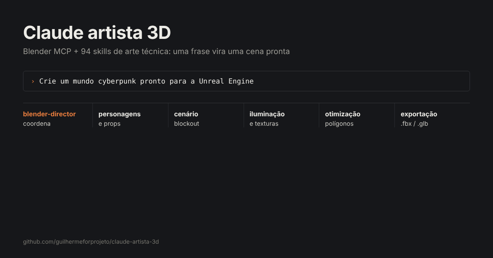

# Claude artista 3D

**Coloque o Claude Code para trabalhar dentro do Blender como um time de arte técnica: 94 skills especializadas, um diretor que coordena todas e um fluxo que mostra cada etapa antes de seguir. Você manda o link para a IA e ela sabe o que fazer.**

🇧🇷 Português | [🇺🇸 English](README.en.md)



---

## Jeito mais fácil: mande o link para a IA

Abra o Claude Code (ou Cursor, Codex, Kiro) na pasta do seu projeto, com o Blender aberto, e cole:

```text
Leia https://github.com/guilhermeforprojeto/claude-artista-3d e siga o AGENTS.md. Quero [descreva a cena, ex.: um mundo cyberpunk pronto para a Unreal].
```

A IA lê o [`AGENTS.md`](AGENTS.md), confere o que já está instalado, pede sua permissão para instalar o que faltar, te guia para ligar o addon no Blender, faz as perguntas do brief e monta a cena seguindo o fluxo do [`CLAUDE.md`](CLAUDE.md).

## O que entra

| Peça | O que faz |
|---|---|
| [**Blender MCP**](https://github.com/ahujasid/mcp-for-blender) | A ponte entre a IA e o Blender: cria e edita objetos, executa Python e tira print do viewport |
| [**Blender Skills**](https://github.com/arjun988/blender-skills) | 94 skills de modelagem, props, cenário, personagens, iluminação, texturas, otimização, exportação e estilos de arte |
| **`blender-director`** | A skill que recebe seu pedido, divide em etapas e chama as especialistas na ordem certa |
| [**`CLAUDE.md`**](CLAUDE.md) (este repositório) | O fluxo: plano → blockout → print → refino → luz e materiais → otimização → exportação, salvando versões no caminho |

## Instalação manual

Precisa de **Blender**, **git** e **Claude Code**. Rode **de dentro da pasta do seu projeto**:

```bash
bash /caminho/para/instalar.sh                                         # macOS / Linux
powershell -ExecutionPolicy Bypass -File C:\caminho\para\instalar.ps1  # Windows
```

O script instala o `uv` se faltar, registra o Blender MCP (com a telemetria desligada) e copia as 94 skills para `.claude/skills/` do projeto. Depois, falta o addon no Blender:

1. Baixe o `addon.py` em [ahujasid/mcp-for-blender](https://github.com/ahujasid/mcp-for-blender).
2. Blender → *Edit → Preferences → Add-ons → Install…* → escolha o `addon.py` → ative **Blender MCP**.
3. No Blender, aperte **N** → aba **BlenderMCP** → **Connect**.
4. Reinicie o Claude Code e peça: *"Use o blender-director para criar…"*

<details>
<summary>Outras formas de instalar</summary>

**Plugin do Claude Code (só as skills):**
```text
/plugin marketplace add arjun988/blender-skills
/plugin install blender-skills@blender-skills
```

**Instalador oficial do Blender MCP (apps + addon):** veja o README do [mcp-for-blender](https://github.com/ahujasid/mcp-for-blender).
</details>

## Exemplos de pedido

- *"Crie um mundo cyberpunk com ruas molhadas e neon, pronto para a Unreal."*
- *"Modele uma espada low poly estilizada e renderize com iluminação de três pontos."*
- *"Monte uma sala de estar realista para archviz, com luz de fim de tarde."*
- *"Faça um personagem cartoon simples e exporte em .glb para usar no site."*

## Realismo por padrão

Modelo em boa resolução ainda pode parecer massinha. O [`prompts/realismo.md`](prompts/realismo.md) obriga a IA a cuidar do que faz o olho acreditar: escala real, quinas chanfradas, cabos com peso e conector em toda ponta, materiais com desgaste (Poly Haven, CC0), luz com direção, fundo habitado e render em Cycles. Ele também explica o que fazer quando você **não tem fotos** do produto.

## Vídeo realista: Blender + Seedance 2.5

Render direto do Blender costuma sair com cara de tutorial. Para anúncio ou reels, use o fluxo de [`prompts/video-produto.md`](prompts/video-produto.md): o Claude escreve o roteiro de shots, monta no Blender um **animatic** com a câmera e o tempo certos, exporta uma prévia de cada shot e ela entra como **referência de movimento no Seedance 2.5**, junto com fotos reais do produto. Interface, logo e textos ficam fora da IA de vídeo e entram na montagem, porque modelos de vídeo distorcem letras e números.

## Antes de usar

- **A IA executa código dentro do seu Blender.** Salve seu trabalho antes e use em arquivos seus. O `CLAUDE.md` manda ela salvar versões antes de mudanças grandes.
- **Ela não substitui o olho do artista.** Ela cuida da parte técnica e repetitiva; composição, estilo e "ficou bom?" continuam sendo decisão sua. Por isso o fluxo mostra prints a cada etapa.
- **Licença de assets.** Se ela baixar modelos ou texturas, tem que te dizer a licença de cada um.

## Créditos

A ideia vem de um vídeo do **[@gabrieladamuchi](https://www.tiktok.com/@gabrieladamuchi)** no TikTok. As **Blender Skills** são de [arjun988 e contribuidores](https://github.com/arjun988/blender-skills) (MIT) e o **Blender MCP** é de [Siddharth Ahuja](https://github.com/ahujasid/mcp-for-blender) (MIT). Este repositório só junta a instalação e escreve o fluxo de trabalho; não redistribui as skills.

## Mais da série

[claude-web-designer](https://github.com/guilhermeforprojeto/claude-web-designer) · [dashboard-sem-cara-de-ia](https://github.com/guilhermeforprojeto/dashboard-sem-cara-de-ia) · [web-moderna-para-ia](https://github.com/guilhermeforprojeto/web-moderna-para-ia) · [seguranca-antes-de-lancar](https://github.com/guilhermeforprojeto/seguranca-antes-de-lancar) · [valide-antes-de-programar](https://github.com/guilhermeforprojeto/valide-antes-de-programar)

Se isso te ajudou, deixa uma ⭐. Ajuda mais gente a achar.

## Licença

[CC BY 4.0](LICENSE) para os textos e scripts deste repositório. As ferramentas instaladas seguem a licença de cada projeto.
